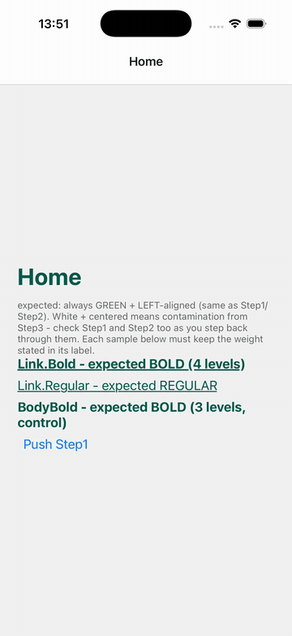
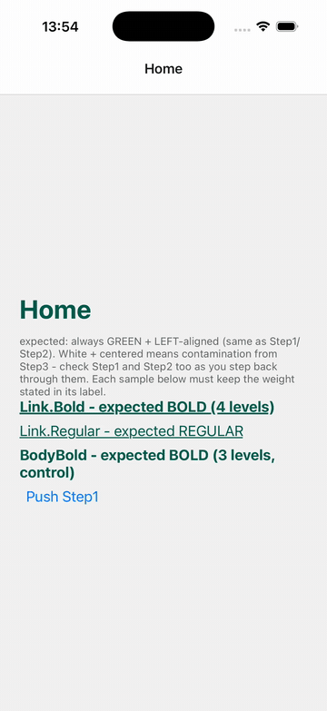

# unistyles-break-theme-repro

Minimal repro for a `react-native-unistyles@3.4.0` bug: a static style nested 3+ arrays deep is
dropped after `react-native-screens` freezes/unfreezes a screen during navigation (e.g. bold text
turns regular).

Follow-up to [#1262](https://github.com/jpudysz/react-native-unistyles/issues/1262) (style leak
between components, fixed in `3.4.0`).

## The issue

`ShadowRegistry.add` flattens the `style` prop only two array levels deep. A static style nested
deeper reaches `link()` as a leftover array and is never parsed as a Unistyle. When a frozen screen
is re-linked on unfreeze, the recomputed style lacks it and overrides what React rendered.

Every screen renders three samples from `src/StyleSamples.tsx`, each labelled with its expected
weight:

| Sample         | Style nesting                                     | Expected | On 3.4.0 after unfreeze |
| -------------- | ------------------------------------------------- | -------- | ----------------------- |
| `Link.Bold`    | 4 levels (`[shared, [link, [regular, [bold]]]]`)  | bold     | **regular**             |
| `Link.Regular` | 3 levels                                          | regular  | regular                 |
| `BodyBold`     | 3 levels (`[shared, [regular, [bold]]]`), control | bold     | bold                    |

The screen headings (weight passed as a dynamic function argument) are a second control.

The app has a single native stack (`Home -> Step1 -> Step2 -> Step3`) with `enableFreeze(true)`.

See [UNISTYLES_REPRO_SPEC.md](./UNISTYLES_REPRO_SPEC.md) for the full investigation.

## Environment

| Package                          | Version                                                            |
| -------------------------------- | ------------------------------------------------------------------ |
| `react-native`                   | 0.87.1                                                             |
| `react`                          | 19.2.3                                                             |
| `react-native-unistyles`         | 3.4.0 (bug) / 3.2.5 (no repro)                                     |
| `react-native-nitro-modules`     | 0.37.1                                                             |
| `react-native-screens`           | 4.28.0                                                             |
| `@react-navigation/native-stack` | 7.19.2                                                             |
| Architecture                     | New Architecture / Fabric (default in RN 0.87)                     |
| Platform tested                  | iOS Simulator (iPhone 17 Pro, iOS 26.2), Release build recommended |

## Installation

```sh
npm run build:ios      # npm install + bundle install + pod install + run iOS app
npm run build:android  # npm install + run Android app
```

`build:ios` runs `bundle install`/`bundle exec pod install` rather than a bare `pod install` so
CocoaPods resolves to the exact version pinned in [Gemfile](./Gemfile) (which excludes known-broken
releases) instead of whatever `pod` happens to be installed globally.

## How to reproduce

1. From `Home`, tap "Push" through `Step1 -> Step2 -> Step3` (this freezes `Home` and `Step1`).
2. Wait a second or two for the freeze to take effect.
3. Tap "Back" repeatedly to walk back one screen at a time (`Step3 -> Step2 -> Step1 -> Home`),
   checking the weight of each labelled sample on every screen.
4. Repeat the push/back cycle a few times.

If the bug is present, `Link.Bold` renders regular instead of bold. `BodyBold` and the heading stay
bold.

### Without a device

```sh
npx jest __tests__/ShadowRegistryFlatten.test.ts
```

Runs the shipped `ShadowRegistry.add` with `link` mocked. The 3-level case passes and the 4-level
case fails. `3.2.5` has the same flattening limit but never recomputes styles on re-link, so it is
only exposed from `3.3.0`
([commit `4d46223`](https://github.com/jpudysz/react-native-unistyles/commit/4d4622379e10e82e7a744e5d3b66c2a0456826b8)).

## Video demonstration

| `3.4.0` (bug present)                            | `3.2.5` (no repro)                                   |
| ------------------------------------------------ | ---------------------------------------------------- |
|  |  |

See [media/README.md](./media/README.md) for the expected filenames if the videos aren't showing.

To confirm the bisection, run each branch's build:

```sh
npm run demo:main   # checks out main (unistyles 3.4.0, bug present) and builds/runs iOS
npm run demo:fixed  # checks out fixed-3.2.5 (unistyles 3.2.5, no repro) and builds/runs iOS
```

`fixed-3.2.5` is identical to `main` except `react-native-unistyles` is pinned to `3.2.5`. Both
scripts run `git checkout` then `npm run build:ios`, so make sure you have no uncommitted changes
before running them.

## Suggested fix

Flatten the style array fully in `ShadowRegistry.add`:

```diff
-    const stylesArray = Array.isArray(styles) ? styles.flat() : [styles]
+    const stylesArray = Array.isArray(styles) ? styles.flat(Infinity) : [styles]

     const filteredStyles = stylesArray
         .filter((style) => style && Object.keys(style).length > 0)
-        .flat()
         .filter(Boolean)
```

## Related upstream reports

- [#1262](https://github.com/jpudysz/react-native-unistyles/issues/1262) - style leak between
  components after freeze/unfreeze (`3.3.0`, fixed in `3.4.0`)
